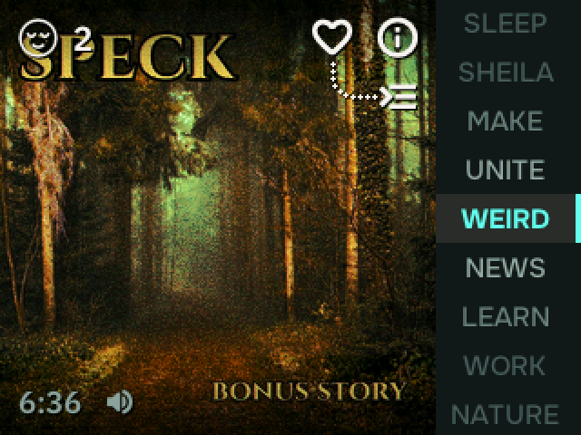

# Static for Chumby One

[Static](https://staticradio.app) is a radio made of podcasts: every station
plays one shared timeline, so everyone tuned in hears the same moment. This
turns a 2009 [Chumby One](https://en.wikipedia.org/wiki/Chumby) into a
dedicated Static radio. The knob is the dial.

Static has nine always-on stations (Learn, Weird, Make, News, Nature, Sleep,
Work, Unite and one built from a WFMU DJ's archive), filled with independent
podcasts picked by hand. There's no account and no algorithm: you spin the dial
and land on whatever is playing, along with everyone else tuned in.

**Static's website: [staticradio.app](https://staticradio.app)**, where you can
also listen in your browser and get the apps for iPhone, iPad, Mac and Android.



Video: [the knob tuning stations](https://youtu.be/yQpOvSauJuE) (26 s).

It is a native client written for the hardware: an i.MX233 (a 454 MHz ARM9 with
no FPU), 60 MB of RAM, a 320×240 touch screen and Linux 2.6.28. It decodes MP3
and HE-AAC itself in fixed point and streams straight from each podcast's
publisher over TLS. It tunes in under a second.

## Install

You need a Chumby One that's already on Wi-Fi (set it up with the stock chumby
screens first) and a USB stick formatted FAT32. It's built and tested on the
Chumby One, the 2009 model with the knob; other chumby models haven't been
tried. Installing is reversible: running from the stick changes nothing, and
**Turn off Static** in the menu puts the stock chumby back.

1. Download `static-chumby-<version>.zip` from
   [Releases](https://github.com/madewith-bestpractice/static-chumby/releases/latest).
2. Unzip it onto the root of the USB stick. You should see `userhook1`,
   `README.txt` and a `static` folder at the top level.
3. Plug the stick into the chumby and restart it (unplug the power, plug it
   back in). Static comes up in place of the stock screens about a minute into
   the boot.

That runs Static from the stick and changes nothing on the chumby. To keep it:
**hold the top button** until the menu opens, tap **Install on this chumby**,
then take the stick out. From then on Static starts at every boot.

## Use

- **Turn the knob** to change stations. The two stations either side are kept
  loaded, so the sound follows each click and crossfades, as on the phone. Tap
  a station name to jump to it.
- **Volume:** hold the top button and turn the knob. Tap the speaker glyph,
  bottom left, to mute.
- **Heart** a show to save it; the list icon under the info dot shows your
  faves. **Info** shows what's on, with a QR code for the episode page.
- **Hold the top button** (without turning) for the system menu:
  - **Chumby settings:** the stock chumby screens, to change Wi-Fi, the time
    zone and so on. Restart the chumby to come back to Static.
  - **Install on this chumby** (from a stick) or **Check for updates**.
  - **Turn off Static:** removes it and goes back to the stock chumby. Your
    faves file is kept.
- The clock follows the chumby's own time zone and 12/24-hour setting.

## Updates

An installed Static checks this repo's latest release twice a day. When there
is a newer version it downloads it in the background, checks its SHA-256, and
installs it in the 4 a.m. hour, or right away if you tap **Install update** in
the menu. If a new version keeps crashing, the chumby goes back to the previous
one by itself. To turn updates off, create `/mnt/storage/static/noupdate`.

## Feedback and bugs

Got a chumby running Static? We'd love to hear about it, and a photo of yours on
the dial would make our week. If something doesn't work (no sound, a station
that won't tune, the stock screens coming back), please
[open an issue](https://github.com/madewith-bestpractice/static-chumby/issues)
with what you saw and the version from the menu. Pull requests are welcome too.

## How it works

| Piece | Where | Notes |
|---|---|---|
| UI, input, event loop | `src/main.c`, `src/ui.c` | Draws to `/dev/fb0` in RGB565. The art panel is composed once per change; a crossfade is one blend per frame. Fonts and icons are pre-rendered into headers by `tools/gen*.swift`. |
| Schedule | `src/sched.c`, `src/json.c` | `schedule-wear.json` from data.staticradio.app, cached on disk. `sched_live()` is the phone's wall-clock-to-episode rule, with a 1.5 s gap between episodes. |
| Network | `src/net.c`, `src/fetch.c` | mbedTLS 3.6. TLS 1.2 by default because its session resumption needs no public-key math (about 0.05 s against 0.5 s here); sessions are saved across restarts. Ranged streaming, and pre-buffers for the stations either side of the needle. |
| Resolve + probe | `src/resolver.c`, `src/mp3probe.c`, `src/mp4.c` | A background thread walks redirect chains ahead of time, then probes each file: MP3 (ID3, bitrate, Xing table), MP4 (`moov` cached on disk with a 256-point seek table) or WAV. |
| Decode | `src/decode.c`, `src/resample.c`, `src/third_party/helix` | One thread per stream: Helix fixed-point MP3/AAC (HE-AAC included), then a 16-tap polyphase resampler to 44.1 kHz. ffmpeg is only a fallback for other formats. |
| Audio | `src/audio.c` | Mixes the decoded PCM so playback sits at the live position. Per-episode loudness gain from the schedule, a 300 ms equal-power station crossfade, pre-buffers for two stations each side of the needle (a click onto one is heard in about half a second), and the next episode pre-launched before its boundary. About 0.4 s of audio is queued ahead. A writer thread (`src/pcmout.c`) feeds the kernel's PCM device directly, with no `aplay` or alsa-lib; `aplay` is the fallback. |
| Updates | `src/update.c`, `toolchain/boot.sh` | See above. `boot.sh` also keeps the client running and hands back to the stock UI if it can't. |

Audio is never proxied or rehosted: the chumby streams straight from publishers.
The art is the phone app's riso-printed look, pre-rendered for this screen on
Static's servers.

Measured on the device: from a cold boot, Static is playing about 7 s after it
starts. Tuning to an MP3 station takes under a second, or about 0.3 s from a
neighbor pre-buffer. While an MP3 station plays, Static uses about 24% of the
CPU in total; a 3-hour HE-AAC show about 44%.

## Build

On macOS or Linux with [zig](https://ziglang.org) 0.17, python3 and curl:

```sh
toolchain/build_deps.sh   # mbedTLS + a trimmed ffmpeg + zig wrappers -> ./deps (a few minutes)
make                      # -> build/static-radio
make dist                 # -> build/static-chumby-<version>.zip + build/latest.json
```

For development on a chumby with SSH (the stock firmware has `sshd`; create
`/psp/start_sshd` to keep it on), `make install-ssh HOST=<chumby>` installs the
dist folder and `make deploy HOST=<chumby>` swaps in just the binary. The
chumby's sshd needs legacy algorithms in your SSH config:
`HostKeyAlgorithms +ssh-rsa`, `KexAlgorithms +diffie-hellman-group1-sha1`,
`Ciphers +aes128-cbc`.

Toolchain notes, all handled by `toolchain/`:

- **zig's ARMv5 runtime lacks `__sync_*` atomics.** `kuser_sync.c` implements
  them with the kernel's user-space cmpxchg helper. 64-bit atomics go through a
  spinlock, because `cmpxchg64` arrived in Linux 3.1.
- **ffmpeg 7.1's large FFT tables are 17 MB of bss**, enough for exec to be
  killed on this device. The patch drops the sizes of 65536 and above.
- **Binaries are stripped at link time** (`-s`); there's no ELF `strip` on macOS.

## Licenses

Static for Chumby One is MIT licensed (`LICENSE`). It bundles other software
under its own licenses; see [THIRD_PARTY.md](THIRD_PARTY.md) and `LICENSES/`.
The Static name, logo and listener faces are trademarks and artwork of
Best Practice and aren't covered by the MIT license.

Not affiliated with or endorsed by Chumby Industries or its successors.
